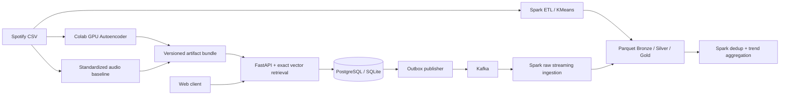

# Kiến trúc và quyết định kỹ thuật

## Hiện thực và giới hạn

- API dùng SQLAlchemy, SQLite cho local và PostgreSQL cho Compose.
- Hash mật khẩu PBKDF2-SHA256, salt ngẫu nhiên, 600.000 vòng. Token ký, hết hạn sau 24 giờ.
- Token lưu sessionStorage ở frontend; chạy cùng origin, không cần mở CORS toàn cục.
- Feedback và event được ghi trong một transaction; event_id là khóa idempotency.
- `unlike` xóa tác dụng của like trong hồ sơ hiện tại, vẫn giữ lịch sử event.
- `dislike` loại bài khỏi kết quả; artist cap giới hạn tối đa 2 bài/nghệ sĩ chính.
- Onboarding genre tạo bonus; khi chưa có like, dùng popularity snapshot làm fallback.
- Recommender đọc artifact khi startup; đổi model bằng MODEL_DIR và restart.
- Tìm kiếm exact cosine là O(Nd) cho mỗi request, phù hợp demo danh mục hiện tại.
  Chưa triển khai ANN index, Redis, collaborative filtering hoặc online learning.
- Outbox publisher một process. Crash sau Kafka ack trước DB commit có thể gửi trùng;
  Spark trend batch khử trùng event_id trên toàn bộ input đã lưu.
- Streaming hiện lưu raw micro-batch; trend là batch chạy lại, chưa phải dashboard streaming tức thời.
- Dashboard web chỉ hiển thị hoạt động của chính tài khoản. Kết quả Spark được xem qua notebook/Parquet.
- `create_all` dành cho khởi tạo schema v1; thay đổi schema production cần Alembic migration.

## Dữ liệu và machine learning

Catalog khử trùng theo track_id, bảo toàn tập genre; chọn metadata theo popularity giảm dần rồi genre.
Audio feature: danceability, energy, loudness, speechiness, acousticness, instrumentalness,
liveness, valence, tempo, duration_ms. Không dùng track_id làm feature, không dùng popularity làm nhãn user.

Autoencoder: 10 → 64 → 8 → 64 → 10, AdamW, noise Gaussian 0.05 trên đầu vào train.
Split 80/10/10 theo track duy nhất, seed 42; scaler fit train; early stopping patience 5.
Artifacts chứa model state, scaler, split, metrics, catalog, embedding và checksum.
GPU có thể không cho hiệu năng tốt hơn CPU với bảng nhỏ này; mục tiêu là pipeline học biểu diễn có thể tái hiện.

## Hướng mở rộng

ANN retrieval, precomputed top-K, Redis, ALS/BPR trên tương tác thật; S3 + Delta Lake;
orchestration Airflow; model registry MLflow; observability; HTTPS/rate limiting;
schema migration; privacy deletion; load test đa host. Các thành phần này chưa được triển khai ở v0.1.
