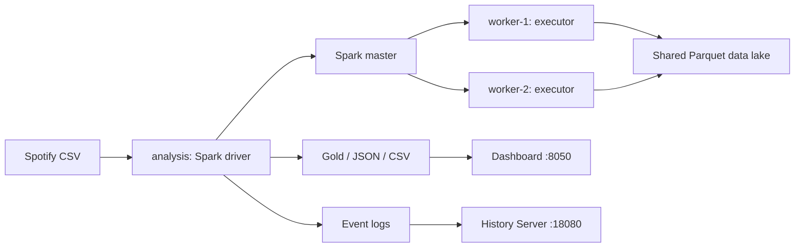

# Hướng dẫn nắm bài trước khi bảo vệ

Tài liệu này giải thích các quyết định kỹ thuật của bản môn Big Data. Số liệu thực nghiệm
đọc từ `reports/bigdata/BAO_CAO_BIGDATA.md` và `run.json` sau khi chạy; không học thuộc một
con số nếu đã chạy lại bằng cấu hình khác.

## 1. Phát biểu bài toán

### 1.1. Lý do chọn đề tài

Danh mục âm nhạc ngày càng đa dạng về thể loại, nghệ sĩ và phong cách biểu diễn. Khi số lượng
bài hát tăng, việc quan sát thủ công khó giúp nhận diện cấu trúc danh mục, các nhóm đặc trưng
tương đồng và những vấn đề chất lượng dữ liệu. Một quy trình phân tích có thể lặp lại giúp
chuyển dữ liệu mô tả bài hát thành các kết quả có căn cứ, phục vụ việc khám phá nội dung và
đặt nền tảng cho các chức năng khai thác âm nhạc sau này.

Vì vậy, đề tài tập trung xây dựng quy trình phân tích có khả năng kiểm tra nguồn dữ liệu,
giải thích cách xử lý và truy nguyên kết quả. Giá trị của bài làm không chỉ là biểu đồ cuối
cùng mà còn là khả năng tái hiện toàn bộ quá trình bằng một môi trường triển khai thống nhất.

### 1.2. Mục tiêu của phiên bản môn học

- Xây dựng môi trường Spark Standalone gồm driver, master và hai worker bằng Docker.
- Kiểm tra, làm sạch và tổ chức dữ liệu thành các lớp Parquet.
- Sử dụng Spark SQL để trả lời các câu hỏi về danh mục âm nhạc.
- Sử dụng MLlib để đo tương quan và tìm các cụm bài hát có đặc trưng tương đồng.
- Đo hiệu năng của một phép tổng hợp với các mức phân vùng đầu vào khác nhau.
- Lưu kết quả, cấu hình chạy, mô hình và thông tin thực thi phục vụ kiểm chứng.

### 1.3. Giới hạn nghiên cứu

Bộ dữ liệu chỉ chứa thông tin bài hát. Không có user_id, phiên nghe, thời điểm phát hay lịch sử
tương tác để chứng minh sở thích cá nhân hoặc sự thay đổi hành vi theo tháng. Vì vậy, phạm vi
hiện tại là **phân tích danh mục âm nhạc**. Gợi ý cá nhân hóa, thu thập sự kiện và huấn luyện
GPU là các phần mở rộng, không phải điều kiện để demo phiên bản này.

## 2. Kiến trúc và luồng dữ liệu

### 2.1. Vai trò của từng thành phần

Driver chạy chương trình Python, tạo SparkSession, xây dựng kế hoạch thực thi và điều phối
các task. Master quản lý tài nguyên của cụm Standalone và cấp executor; master không trực tiếp
thay driver tính thống kê. Worker là tiến trình quản lý executor trên máy/container của mình.
Executor thực thi task, giữ cache và trao đổi dữ liệu khi có shuffle.

Hai worker đăng ký tổng cộng bốn core. Job giới hạn bốn core, mỗi executor hai core và bộ nhớ
heap 512 MB. Driver có heap 1 GB. Heap không phải tổng RAM của container: JVM, Python và hệ điều
hành còn cần bộ nhớ ngoài heap. Cấu hình này phục vụ demo nhỏ trên máy cá nhân.

### 2.2. Storage và khả năng tái hiện

Các container mount cùng thư mục host vào `/workspace/data`. Vì vậy đường dẫn Parquet có cùng
nội dung khi được truy cập từ driver hoặc worker. Đây là phương án thuận tiện cho một host;
không thể giữ nguyên bind mount này rồi coi đó là hệ lưu trữ phân tán khi chuyển sang nhiều máy.

Bronze giữ dữ liệu nguồn dưới dạng Parquet với các trường CSV ban đầu. Silver chứa danh mục
đã làm sạch và bảng quan hệ bài hát–thể loại. Gold chứa các bảng thống kê và nhãn cụm theo bài.
Mô hình được lưu dưới dạng Spark PipelineModel, tách khỏi bảng nhãn đã suy diễn.

Docker cố định môi trường thực thi; các phiên bản thư viện được khai báo trong image. Cùng
mã nguồn và dữ liệu có thể chạy lại, nhưng thời gian chạy và thứ tự nhãn cụm không phải hằng số
trên mọi máy. Mã SHA256 giúp nhận biết chính xác dữ liệu đã sử dụng.

## 3. Phương pháp xử lý dữ liệu

### 3.1. Đọc và kiểm tra dữ liệu

CSV được đọc với header, hỗ trợ trường nhiều dòng và dấu nháy kép. Chương trình kiểm tra sự
tồn tại của các cột cần thiết trước khi tính toán. Các cột số được ép kiểu rõ ràng; giá trị
không ép kiểu được chuyển thành null để loại theo quy tắc. Không dựa hoàn toàn vào suy đoán
schema của Spark từ một phần mẫu.

Các điều kiện hợp lệ gồm thông tin nhận dạng và feature không null, thời lượng lớn hơn không,
popularity trong khoảng 0–100 và các đặc trưng tỷ lệ trong khoảng 0–1. Thống kê thiếu dữ liệu
được đo trên dữ liệu ban đầu. Số dòng thiếu từng cột không được cộng trực tiếp thành số dòng
bị loại, vì một dòng có thể thiếu nhiều cột.

### 3.2. Khử trùng và bảo toàn thể loại

Đơn vị phân tích là `track_id`, không phải tên bài. Hai bản thu có thể cùng tên nhưng có mã
khác nhau. Ngược lại, cùng một mã có thể xuất hiện ở nhiều thể loại. Nếu xóa các dòng trùng mã
ngay từ đầu mà không giữ quan hệ genre, kết quả thống kê thể loại sẽ mất thông tin.

Chương trình tạo `track_genres` từ các cặp mã bài–thể loại phân biệt. Metadata được chọn bằng
Window `partitionBy(track_id)`, sắp popularity giảm dần rồi genre, lấy `row_number = 1`.
Đây là quy tắc lựa chọn metadata trong phạm vi bài làm; khi các nguồn ghi metadata mâu thuẫn,
hệ thống thực tế cần chính sách ưu tiên nguồn hoặc thời điểm cập nhật.

Khi JOIN danh mục với `track_genres`, một bài thuộc hai genre đóng góp một lần vào mỗi genre.
Do đó tổng số bài của tất cả genre có thể lớn hơn số bài phân biệt. Các phân bố duration,
popularity và cluster được tính trên danh mục một dòng mỗi bài nên tổng phải bằng số bài hợp lệ.

### 3.3. Vì sao dùng Parquet

Parquet lưu theo cột, có schema và phù hợp với các truy vấn chỉ cần một số trường. Tách các lớp
giúp đọc lại kết quả trung gian và kiểm tra ETL. Không khẳng định mọi truy vấn đều nhanh hơn CSV:
lợi ích cụ thể còn phụ thuộc kích thước dữ liệu, số file, phép lọc và điều kiện cache.

## 4. Phân tích bằng Spark SQL

### 4.1. Các câu hỏi và đơn vị đo

| Câu hỏi | Phép xử lý | Cách diễn giải |
|---|---|---|
| Genre nào có popularity trung bình cao? | JOIN, GROUP BY, AVG | Trung bình trong mẫu tại snapshot |
| Nghệ sĩ nào có nhiều bài? | SPLIT, EXPLODE, COUNT DISTINCT | Số track có ghi nhận nghệ sĩ, gồm cộng tác |
| Các bài thường dài bao nhiêu? | CASE WHEN, GROUP BY | Số bài theo khoảng thời lượng |
| Popularity phân bố thế nào? | FLOOR, GROUP BY | Số bài theo nhóm điểm, có nhóm riêng cho 100 |
| Những bài nào có điểm cao nhất? | ORDER BY, LIMIT | Top bài trong bộ dữ liệu đã làm sạch |

Popularity là điểm trong dataset, không được đổi tên thành lượt nghe. Danh sách nghệ sĩ cộng
tác được tách theo dấu chấm phẩy, trim khoảng trắng và đếm mã bài phân biệt. Một bài cộng tác
có thể được ghi nhận cho nhiều nghệ sĩ, nên tổng giữa các nghệ sĩ cũng không phải số bài duy nhất.

### 4.2. Lazy evaluation, cache và shuffle

Các phép `select`, `filter`, `join` chủ yếu tạo kế hoạch; action như `count`, `collect`, `write`
mới kích hoạt thực thi. Cache được dùng ở các DataFrame tái sử dụng nhiều lần, sau đó giải phóng
trước benchmark để tránh đo lại riêng dữ liệu đã cache bởi ứng dụng.

GROUP BY và repartition có thể yêu cầu trao đổi dữ liệu giữa executor. Trong kế hoạch vật lý,
cần tìm các node như Exchange, HashAggregate và Sort; kiểu join thực tế phụ thuộc optimizer.
`query-plans.txt` lưu kế hoạch tại lúc gọi explain. Spark History cho phép xem các stage và kế
hoạch của lần thực thi, bao gồm thay đổi do Adaptive Query Execution nếu có.

Chỉ các bảng đã tổng hợp, được giới hạn số dòng, được collect về driver cho dashboard. Dữ liệu
chi tiết và nhãn của toàn bộ bài hát vẫn được ghi Parquet qua Spark. Pandas ở bước xuất CSV chỉ
định dạng bảng nhỏ, không thay Spark thực hiện phân tích chính.

## 5. Tương quan và phân cụm

### 5.1. Pearson

VectorAssembler ghép mười feature số theo thứ tự cố định. MLlib tính ma trận Pearson trên các
vector này. Hệ số dương biểu thị xu hướng biến thiên cùng chiều tuyến tính, hệ số âm biểu thị
ngược chiều, gần không là ít liên hệ tuyến tính. Quan hệ phi tuyến vẫn có thể tồn tại khi
Pearson nhỏ. Không kết luận nhân quả hay mức yêu thích của người dùng từ ma trận này.

### 5.2. Chuẩn hóa và KMeans

Nếu dùng trực tiếp duration_ms, tempo và các feature tỷ lệ, đơn vị có độ lớn cao có thể chi
phối khoảng cách. StandardScaler trừ trung bình và chia độ lệch chuẩn trước KMeans. KMeans
tìm các tâm cụm để giảm tổng khoảng cách bình phương từ điểm đến tâm được gán.

Sau khử trùng, chia theo hash track_id thành train/validation/test với tỷ lệ xấp xỉ 70/15/15.
Scaler chỉ fit trên train; các k=3,5,7,9 cùng seed=42, tối đa 50 vòng lặp, tol=1e-4 được so sánh bằng
silhouette validation. Chỉ đánh giá test sau khi chọn k. Đây là lựa chọn tốt nhất trong tập
ứng viên theo metric đã định, không chứng minh tối ưu toàn cục. Nhãn cụm chỉ là định danh;
cụm 0 không có nghĩa tốt hơn cụm 1. Diễn giải bằng trung bình feature gốc trong bảng profile.

Sau đánh giá, refit trên toàn danh mục để xuất nhãn phân tích. Báo cáo phân biệt điểm test của
mô hình train và điểm mô tả của mô hình refit. Cả hai mô hình đều được lưu; mô hình refit được
nạp lại và đối chiếu dự đoán trên 100 mã bài. Không dùng điểm test để quay lại chọn k khác.

### 5.3. Đánh giá và trực quan

Silhouette so sánh mức độ gần trong cụm và với cụm khác; evaluator của bản này dùng squared
Euclidean. Giá trị cao hơn thường thể hiện sự tách cụm tốt hơn theo metric đó. Đây không phải
accuracy, không so sánh với nhãn genre và không chứng minh chất lượng gợi ý cá nhân hóa.

Biểu đồ energy–valence chỉ hiển thị 500 bài được chọn theo hash. Mô hình được huấn luyện trên
toàn bộ danh mục và mười chiều. Điểm chồng nhau trong hình hai chiều không có nghĩa chúng trùng
nhau trong không gian mười chiều. Khi trình bày, luôn nêu rõ giới hạn của phép chiếu này.

## 6. Thực nghiệm và kiểm chứng

### 6.1. Thiết kế benchmark

Đầu vào được ghi Parquet một lần. Mỗi lượt đọc cùng đầu vào, hash repartition theo artists
thành 2, 4 hoặc 8 phần, tổng hợp popularity theo artists, rồi tổng lại làm checksum. AQE tắt
trong benchmark và shuffle.partitions được đặt cùng số phần để tránh coalescing tự động.
Mỗi cấu hình được warm-up một lần; sau đó chạy ba vòng đo, xáo trộn thứ tự cấu hình trong từng
vòng bằng seed=42. Báo cáo trung vị, nhỏ nhất, lớn nhất và giữ từng lượt theo thứ tự thực thi.
Thời gian gồm đọc và action thực tế. Stage tổng cuối vẫn có thể chỉ có một task; không tuyên
bố mọi stage đều có số task bằng số partition đầu vào.

Hệ số scale tạo bản sao cho kiểm thử tải, không thêm bài thật. Không đưa các bản sao này vào
phân tích danh mục hoặc coi chúng là quan sát độc lập. Hai worker container chia sẻ CPU, RAM
và ổ đĩa nên không thể từ benchmark này tuyên bố tốc độ khi triển khai trên nhiều máy vật lý.

### 6.2. Điều kiện nghiệm thu

- Hai worker đăng ký ALIVE; lần chạy có hai executor thực sự kết nối.
- Số dòng thô = số dòng hợp lệ + số dòng bị loại.
- Số dòng hợp lệ = số bài duy nhất + số dòng lặp mã đã gộp.
- Tổng phân bố duration, popularity và tổng các cụm bằng số bài duy nhất.
- Ma trận tương quan hữu hạn, đối xứng và có hệ số nằm trong miền hợp lệ.
- Chín lượt đo và ba warm-up có checksum bằng nhau; model, báo cáo và kế hoạch SQL đã được lưu.
- K được chọn bằng validation; test không tham gia chọn k; nạp lại model không đổi dự đoán.
- Dashboard đọc được kết quả thật, không có lỗi JavaScript và không tràn ngang màn hình nhỏ.

### 6.3. Trình tự demo ngắn

Mở terminal chạy `docker compose -f compose.bigdata.yaml ps`, sau đó mở Master UI để chỉ ra
hai worker. Mở History Server, chọn application ID trùng `run.json`, tìm một job và một stage
để giải thích task/shuffle. Chuyển sang dashboard, trình bày một kết quả chất lượng dữ liệu,
một kết quả SQL và profile của một cụm. Kết thúc bằng benchmark và giới hạn dữ liệu snapshot.

Trước buổi bảo vệ cần chạy pipeline và kiểm tra kết quả ít nhất một lần. Có thể giữ dịch vụ
đang chạy để demo; không cần tải lại thư viện hoặc huấn luyện lại ngay trước giảng viên. Nếu
Internet không có, image đã build cùng dataset, Parquet, model và kết quả trên máy vẫn sử dụng
được. Tránh `docker system prune` trước buổi bảo vệ vì có thể xóa cache/image cần thiết.

## 7. Tài liệu đối chiếu

- Dataset: https://www.kaggle.com/datasets/maharshipandya/-spotify-tracks-dataset
- Spark Standalone: https://spark.apache.org/docs/4.0.1/spark-standalone.html
- Spark SQL: https://spark.apache.org/docs/4.0.1/sql-programming-guide.html
- Spark MLlib: https://spark.apache.org/docs/4.0.1/ml-guide.html
- Monitoring: https://spark.apache.org/docs/4.0.1/monitoring.html

Các giải thích triển khai phải đối chiếu với mã `bigdata/analyze.py` và kết quả của chính lần
chạy đang trình bày. Không lấy số liệu minh họa từ tài liệu Spark làm kết quả thực nghiệm của đề tài.
